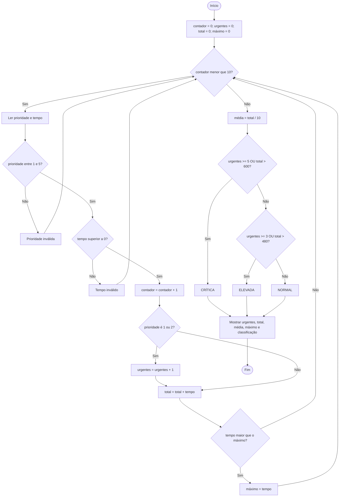

# UC00245 · Gestão de pedidos de suporte técnico

Exercício de Avaliação Prática Integrada. O programa confirma a lógica. O raciocínio está neste documento.

Como correr, num sítio onde exista Python (por exemplo um Codespace deste repositório):

```text
python programa.py
python test_programa.py
```

`programa.py` pede 10 pedidos válidos no teclado. Prioridade ou tempo inválidos não entram na contagem. `test_programa.py` executa a mesma função `main` e a análise usada por ela.

## 1. Análise do problema

A equipa de suporte precisa de decidir como está a carga de trabalho antes de distribuir os pedidos pelos técnicos. O algoritmo não escolhe o técnico. Resume 10 pedidos e classifica a carga em CRÍTICA, ELEVADA ou NORMAL.

| Elemento | Resposta |
| --- | --- |
| Problema a resolver | Resumir exatamente 10 pedidos de suporte e classificar a carga. |
| Inputs | Para cada pedido: prioridade inteira de 1 a 5 (1 é a mais urgente) e tempo estimado em minutos. |
| Outputs | Número de urgentes, total de minutos, média, maior estimativa e classificação. |
| Restrições | Exatamente 10 pedidos válidos. Prioridade fora de 1–5 é recusada. Tempo igual ou inferior a zero é recusado. Um valor recusado não incrementa o contador. |
| Condições / regras | Urgente: prioridade 1 ou 2. CRÍTICA: 5 ou mais urgentes, ou total superior a 600 minutos. ELEVADA: 3 ou mais urgentes, ou total superior a 480 minutos. NORMAL: os restantes. CRÍTICA é testada antes de ELEVADA. |

## 2. Decomposição

1. Entrada. Ler prioridade e tempo do pedido atual.
2. Validação. Aceitar só prioridade inteira de 1 a 5 e tempo inteiro superior a zero.
3. Repetição. Voltar a pedir enquanto houver menos de 10 pedidos válidos.
4. Contagem. Somar um urgente quando a prioridade é 1 ou 2.
5. Cálculo. Somar o tempo ao total e atualizar o máximo.
6. Média. Dividir o total por 10 só depois de fechar a recolha.
7. Decisão. Aplicar CRÍTICA, depois ELEVADA, depois NORMAL.
8. Saída. Mostrar urgentes, total, média, maior estimativa e classificação.

## 3. Planeamento das variáveis

| Variável | Tipo | Finalidade | Valor inicial |
| --- | --- | --- | --- |
| contador_pedidos | inteiro | Quantos pedidos válidos já entraram. O ciclo pára em 10. | 0 |
| contador_urgentes | inteiro | Quantos pedidos têm prioridade 1 ou 2. | 0 |
| total_minutos | inteiro | Soma dos tempos aceites. | 0 |
| maior_estimativa | inteiro | Maior tempo aceite. Todo o tempo válido é superior a zero, por isso o primeiro substitui este zero. | 0 |
| media | real | Total dividido por 10. | calculada no fim |
| prioridade | inteiro | Prioridade do pedido que está a ser lido. | lida em cada volta |
| tempo | inteiro | Minutos do pedido que está a ser lido. | lido em cada volta |
| classificacao | texto | CRÍTICA, ELEVADA ou NORMAL. | decidida no fim |

## 4. Pseudocódigo

```text
INÍCIO
    contador_pedidos ← 0
    contador_urgentes ← 0
    total_minutos ← 0
    maior_estimativa ← 0

    ENQUANTO contador_pedidos < 10 FAZER
        LER prioridade
        LER tempo
        SE prioridade não é inteiro entre 1 e 5 ENTÃO
            ESCREVER "Prioridade inválida"
        SENÃO SE tempo não é inteiro superior a 0 ENTÃO
            ESCREVER "Tempo inválido"
        SENÃO
            contador_pedidos ← contador_pedidos + 1
            SE prioridade = 1 OU prioridade = 2 ENTÃO
                contador_urgentes ← contador_urgentes + 1
            FIM SE
            total_minutos ← total_minutos + tempo
            SE tempo > maior_estimativa ENTÃO
                maior_estimativa ← tempo
            FIM SE
        FIM SE
    FIM ENQUANTO

    media ← total_minutos / 10

    SE contador_urgentes ≥ 5 OU total_minutos > 600 ENTÃO
        classificacao ← "CRÍTICA"
    SENÃO SE contador_urgentes ≥ 3 OU total_minutos > 480 ENTÃO
        classificacao ← "ELEVADA"
    SENÃO
        classificacao ← "NORMAL"
    FIM SE

    ESCREVER contador_urgentes, total_minutos, media, maior_estimativa, classificacao
FIM
```

Um pedido inválido regressa ao teste do ciclo e não altera contadores, total nem máximo.

## 5. Fluxograma

O desenho é o mesmo algoritmo. Cada recusa volta ao teste `contador < 10`. Não há caminho sem saída: ou o pedido é recusado e o ciclo continua, ou entra e o ciclo continua, até haver 10 válidos. Depois há uma única saída, com a classificação.



## 6. Programa

O ficheiro `programa.py` traduz este pseudocódigo. A repetição é um ciclo `while` porque o número de leituras pode ser maior do que 10: as leituras inválidas não contam. A classificação está na função `classificar_carga`, chamada só depois dos 10 pedidos. Os limites estão com nome (`LIMITE_CRITICA_MINUTOS = 600`, e os restantes) para a ordem e os limiares ficarem visíveis. Esses nomes não mudam as regras.

## 7. Matriz de testes

O esperado foi definido pelas regras do enunciado antes de olhar para o resultado obtido. A coluna Obtido vem da execução de `programa.py` em 17/11/2026: 13 testes, todos PASS. Os casos T1, T2, T3 e T5 entram por `main`. Os casos de fronteira e a regressão entram por `analisar_pedidos`, a mesma função que `main` chama depois da recolha.

| ID | Tipo | Cenário / entrada | Esperado | Obtido | PASS/FAIL |
| --- | --- | --- | --- | --- | --- |
| T1 | Normal | 10 pedidos de 40 min; prioridades 1, 2 e oito vezes 5 | 2 urgentes; total 400; média 40; máximo 40; NORMAL | 2; 400; 40; 40; NORMAL | PASS |
| T2 | Inválido — prioridade | Texto `abc`, prioridade 0 e prioridade 6, depois dez pedidos (3, 20) | Os inválidos não contam. 0 urgentes; total 200; média 20; máximo 20; NORMAL | Igual ao esperado | PASS |
| T3 | Inválido — tempo | Tempos 0, -5 e texto, depois dez pedidos (4, 50) | Os inválidos não contam. 0 urgentes; total 500; média 50; máximo 50; ELEVADA | Igual ao esperado | PASS |
| T4a | Fronteira — 3 urgentes | Três urgentes e sete de prioridade 3, 10 min cada. Total 100 | ELEVADA, porque 3 urgentes e o total não chega a CRÍTICA | 3 urgentes; total 100; ELEVADA | PASS |
| T4b | Fronteira — 5 urgentes | Cinco prioridades 1 e cinco prioridades 5, 10 min. Total 100 | CRÍTICA por causa dos 5 urgentes, mesmo com total baixo | 5 urgentes; total 100; CRÍTICA | PASS |
| T4c | Fronteira — 480 min | Dois urgentes e total exatamente 480 | NORMAL. 480 não é superior a 480 e 2 urgentes não chegam a 3 | 2 urgentes; total 480; NORMAL | PASS |
| T4d | Fronteira — 481 min | Dois urgentes e total 481 | ELEVADA, porque 481 é superior a 480 | total 481; ELEVADA | PASS |
| T4e | Fronteira — 600 min | Dois urgentes e total exatamente 600 | ELEVADA. 600 não é superior a 600, mas é superior a 480 | 2 urgentes; total 600; ELEVADA | PASS |
| T4f | Fronteira — 601 min | Dois urgentes e total 601 | CRÍTICA, porque 601 é superior a 600 | total 601; CRÍTICA | PASS |
| T5 | Extremo | Dez pedidos de prioridade 1 e 1 minuto | 10 urgentes; total 10; média 1; máximo 1; CRÍTICA | Igual ao esperado | PASS |
| T6 | Regressão | Dez pedidos de prioridade 2 e 1 minuto | A prioridade 2 conta. 10 urgentes; CRÍTICA | 10 urgentes; CRÍTICA | PASS |

Saída real do programa no caso T1:

```text
Pedidos urgentes: 2
Total de minutos: 400
Média: 40
Maior estimativa: 40
Classificação: NORMAL
```

## 8. Registo de depuração

Condição escrita por um colega:

```text
se prioridade < 2 então
    urgentes ← urgentes + 1
```

Caso que revela o erro: um pedido com prioridade 2 e tempo 1. A regra do enunciado diz que prioridade 2 é urgente. A condição `prioridade < 2` é falsa para 2, por isso o contador fica em 0. Dez pedidos desses dariam 0 urgentes e classificação NORMAL. O resultado certo é 10 urgentes e CRÍTICA.

A diferença: `< 2` só apanha a prioridade 1. A regra é prioridade 1 ou prioridade 2.

Correção mínima: trocar `<` por `<=`, ficando `prioridade <= 2`. No programa a forma equivalente, e mais explícita, é `prioridade == 1 ou prioridade == 2`. As duas aceitam 1 e 2 e recusam 3, 4 e 5 depois da validação.

Reteste: T6 corre os dez pedidos de prioridade 2. Obtido: 10 urgentes e CRÍTICA. PASS.

Melhoria de clareza que não altera os requisitos: os limiares 5, 3, 600 e 480 têm nome no código, e a média só é calculada quando o contador chega a 10. Assim evita-se dividir a meio da recolha ou testar ELEVADA antes de CRÍTICA.

## 9. Defesa técnica

Usei um ciclo enquanto o contador for menor que 10. Um ciclo de exatamente 10 voltas saltaria pedidos inválidos ou, pior, contava-os. Com o `while`, cada recusa volta ao mesmo teste e só um pedido válido faz o contador avançar.

A prioridade só entra se for um inteiro de 1 a 5. Texto, número decimal e valores como 0 ou 6 são pedidos outra vez. O mesmo acontece ao tempo: tem de ser um inteiro superior a zero. O pedido rejeitado não muda urgentes, total nem máximo.

O operador OU aparece em dois sítios. Na contagem: a prioridade é urgente se for 1 ou 2. Na classificação: CRÍTICA se os urgentes forem 5 ou mais, ou se o total passar de 600. ELEVADA usa outro OU: 3 ou mais urgentes, ou total superior a 480.

O máximo começa em 0. Como um tempo aceite é sempre maior que 0, o primeiro pedido substitui esse 0. Nas voltas seguintes o máximo só muda quando o tempo novo é maior.

Testar 3 e 5 urgentes separa as duas regras de contagem. Com total baixo, 3 urgentes têm de dar ELEVADA e não CRÍTICA. Com o mesmo total baixo, 5 urgentes têm de dar CRÍTICA. Se a ordem estivesse trocada, 5 urgentes cairiam em ELEVADA, porque 5 também é "3 ou mais". Por isso CRÍTICA é testada primeiro.

O teste que mais confiança me deu foi o do total 600 com apenas 2 urgentes. O resultado tem de ser ELEVADA, não CRÍTICA: "superior a 600" não inclui 600. O teste dos 480 minutos confirma o mesmo tipo de fronteira do outro lado, e fica NORMAL.

## 10. Checklist de entrega

- Inputs, outputs, restrições e condições estão na análise.
- O problema foi decomposto antes do código.
- O pseudocódigo tem validação, ciclo, contador, totalizador, máximo e decisão.
- O fluxograma segue o pseudocódigo, incluindo as voltas dos dados inválidos.
- O programa executa as mesmas regras.
- A matriz cobre caso normal, inválidos e fronteiras de 3 urgentes, 5 urgentes, 480 e 600 minutos.
- O OU está na regra de urgente e nas regras de classificação.
- CRÍTICA é decidida antes de ELEVADA.
- A correção da condição `prioridade < 2` está registada e retestada.
- A defesa acima serve para explicar a solução em 3 a 5 minutos.
